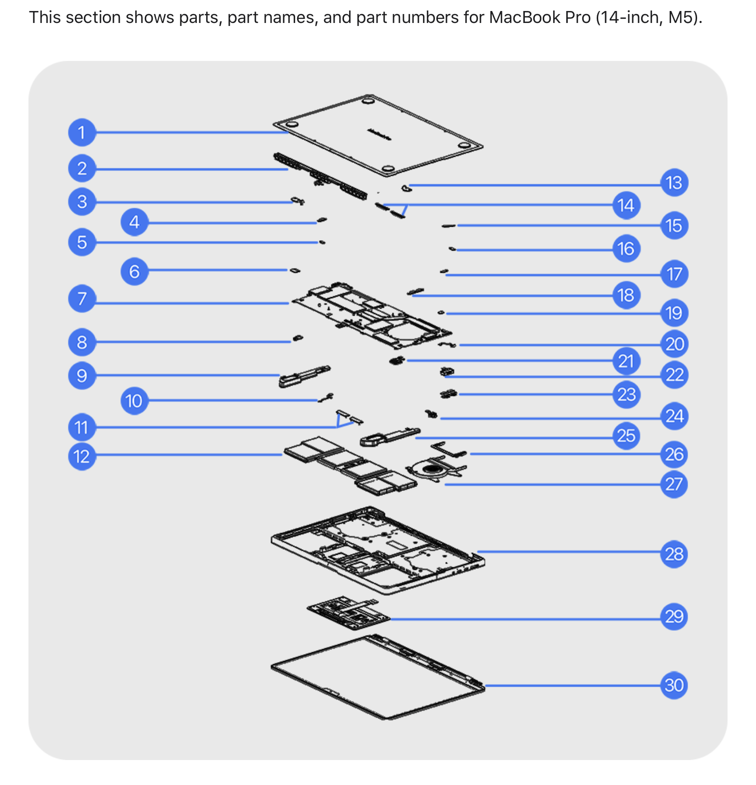

# Lab 3: Teardown without a screwdriver

## 1. The machine

- **Model:** MacBook Pro (14-inch, M5), Model Identifier `Mac17,2`, Model Number `MDE04LL/A`
- **Chip:** Apple M5, 10 cores (4 super + 6 efficiency), 16 GB unified memory (LPDDR5), 512 GB SSD
- **How I found it:** `system_profiler SPHardwareDataType` on the host Mac (not in a VM). Output saved in `evidence/macos-specs.txt`.
- **Service manual:** Apple, *MacBook Pro (14-inch, M5) Repair Manual*, Manual ID XCYLHG, from Apple Self Service Repair.
  Parts figure: https://support.apple.com/en-kz/123176 (Exploded View and Orderable Parts)
- **Second source:** Apple *MacBook Pro (14-inch, M5) – Tech Specs* page.
- **Check that the manual matches my machine:** the manual lists logic board `661-53087` as "10-core CPU, 10-core GPU, 16 GB, 512 GB", which is exactly what my Mac reports.

## 2. Components

*Figure 1. Exploded view from the Apple manual (numbers are Apple's own).*

| # | What | Connects to | Limits |
|---|------|-------------|--------|
| 1 | Bottom case | Top case (28) | Colour-specific part (923-13414 space black, 923-13415 silver) |
| 2 | Vent/antenna module | Logic board, via antenna coaxial cable (15) | Replaced as one module (923-10891) |
| 3, 13 | Right / left display hinge cover | Display hinges (30) | Separate parts, colour-specific |
| 4, 5, 6, 14-19 | Connector cowlings (USB-C, Touch ID, trackpad, display, antenna, lid angle sensor, MagSafe 3, audio board) | Cover the matching connectors on the logic board | Small separate parts |
| 7 | Logic board | USB-C boards, audio board, MagSafe 3 board, Touch ID board, fan, display, battery management unit flex cable | CPU, GPU, RAM and SSD are on this board. The part number fixes the configuration (661-53087 = 10-core CPU, 10-core GPU, 16 GB, 512 GB). No separate RAM, SSD or CPU part exists in the parts list |
| 8, 23 | USB-C boards | Logic board | Part 923-13410 |
| 9, 25 | Right / left speaker | Audio board (24) | Sold only as a pair (923-13419) |
| 10 | Battery management unit flex cable | Battery (12) and logic board | Part 923-13417 |
| 11 | Display bumpers | Display (30) and top case | Part 923-13418 |
| 12 | Battery | Battery management unit flex cable (10) | Parts 661-55016 / 923-13965 |
| 20 | Lid angle sensor | Logic board | Part 661-55012 |
| 21 | Touch ID board | Logic board | Part 661-55013 |
| 22 | MagSafe 3 board | Logic board | Colour-specific (923-13412 / 923-13413) |
| 24 | Audio board | Speakers and logic board | Part 923-13411 |
| 26 | Fan duct cover | Fan (27) | Part 923-12062 |
| 27 | Fan | Logic board | One fan only, which limits sustained cooling. Part 923-13416 |
| 28 | Top case with battery and keyboard | Everything mounts to it | Keyboard and battery come as one assembly; colour-specific |
| 29 | Trackpad | Logic board, via its flex cable | Flex cable included in the part; colour-specific |
| 30 | Display | Logic board and hinges | Four variants: standard / nano-texture, space black / silver |

<!-- TODO before submitting: check the "Connects to" column against the manual's Logic Board, Battery, Fan and Speakers pages, and add the page name where you checked. -->

## 3. Upgrade verdict

| Component | Manual says | OS says | Verdict |
|-----------|-------------|---------|---------|
| Memory | No separate memory part in the parts list; RAM size is part of the logic board part number (661-53087 = 16 GB). Tech Specs: "unified memory", chosen at purchase (Exploded View and Orderable Parts, item 7; Tech Specs, Memory) | `SPMemoryDataType`: 16 GB, Type LPDDR5, Manufacturer Micron, no module list; `hw.memsize` = 17179869184 | **No.** Memory is part of the chip package / logic board; no slots |
| Storage | No separate SSD part; storage size is part of the logic board part number (661-53087 = 512 GB), item 7 | `diskutil info disk0`: APPLE SSD AP0512Z, Protocol Apple Fabric, Internal, Fixed, Solid State: Yes | **No.** It is not a standard M.2 drive; a 2280 NVMe drive cannot be installed |
| CPU | CPU is part of the logic board part number ("10-core CPU, 10-core GPU"), item 7 | `Chip: Apple M5`, `hw.physicalcpu` = 10 | **No.** The CPU is a system-on-chip on the logic board; only the whole board can be replaced |

**Manual vs OS:** I found no disagreement. The manual and the OS give the same configuration (16 GB, 512 GB, M5). Note that the OS output cannot prove "soldered": it only shows there are no separate modules. The proof is the manual, where memory, SSD and CPU exist only as part of the logic board.

## 4. Same facts, different OS

The Linux column comes from the Ubuntu VM in VMware Fusion, so **all Linux values are virtual**. The macOS column is the real machine.

| Fact | macOS (host, real) | Linux (VM, virtual) |
|------|--------------------|---------------------|
| CPU model | `sysctl -n machdep.cpu.brand_string` = Apple M5 | `lscpu` Model name = `-` (empty), Vendor ID = Apple |
| Physical cores | `hw.physicalcpu` = 10 | `lscpu` Core(s) per socket 2 x Socket(s) 1 = 2 |
| Logical CPUs | `hw.logicalcpu` = 10 | `lscpu` CPU(s) = 2 (VM allocation) |
| Total memory | `hw.memsize` = 17179869184 bytes (16 GiB) | `free -h` total = 5.3Gi (`dmidecode`: 4 GiB + 2 GiB modules) |
| Memory type | `SPMemoryDataType` Type = LPDDR5, Micron | `dmidecode -t memory` Type = DRAM, Manufacturer = VMware Virtual RAM, Form Factor = DIMM |
| Memory slots | none (memory is part of the logic board) | `dmidecode -t 16` Number Of Devices = 64, only 2 populated |
| Disk is SSD? | `diskutil info disk0` Solid State = Yes | `lsblk` ROTA = 0 (not rotational) |
| Disk interface | `diskutil` Protocol = Apple Fabric | `lsblk` TRAN = nvme (VMware Virtual NVMe Disk, 20G) |
| Motherboard | `Model Identifier` = Mac17,2 (no separate board) | `dmidecode -t baseboard` Manufacturer = VMware, Inc., Product Name = VBSA |

**What differed.** The same fact has a different name in each OS: the CPU is `Chip` / `machdep.cpu.brand_string` on macOS but `Model name` in `lscpu`, and total memory is `hw.memsize` in bytes on macOS but `free -h` in GiB on Linux. The disk interface is called `Protocol` on macOS and `TRAN` on Linux. The biggest differences between host and VM are virtual: the VM shows 2 CPUs instead of 10, an empty CPU model name, a memory array of 64 DIMM slots with only two filled (the real Mac has no slots at all), and a "VMware Virtual NVMe Disk" instead of Apple's own SSD interface. These values describe the hypervisor, not the real hardware, which is why Part A (the upgrade verdict) was answered from the host and the manual, not from the VM. Also `free -h` shows 5.3Gi although `dmidecode` lists 6 GiB of modules: the kernel and firmware reserve part of the memory.

## Evidence

- `evidence/macos-specs.txt`: commands and output from the host Mac
- `evidence/linux-specs.txt`: commands and output from the Ubuntu VM (virtual values)
- `evidence/manual-figures/figure1-exploded-view.png`: figure from the manual
