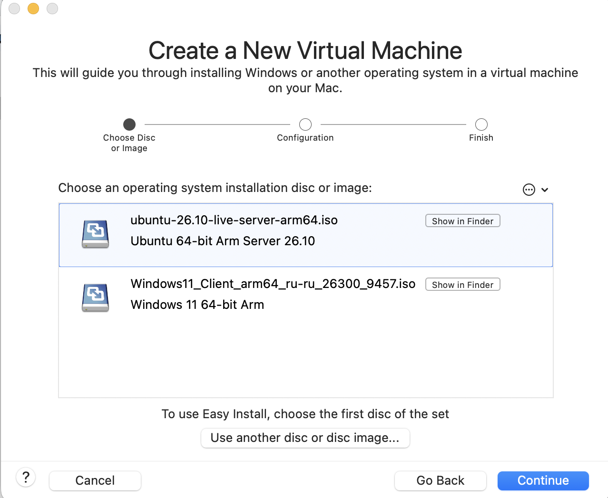
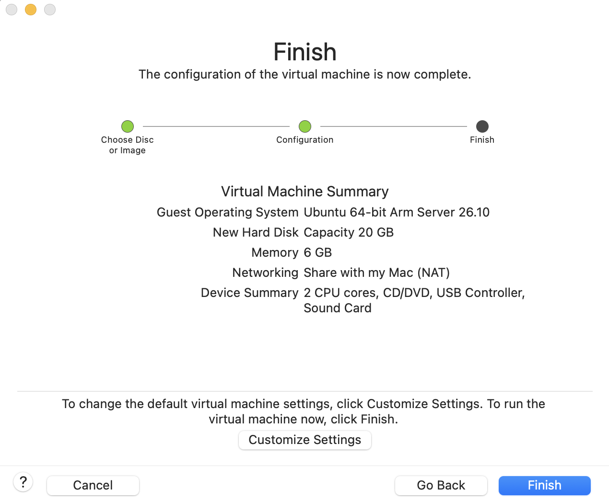
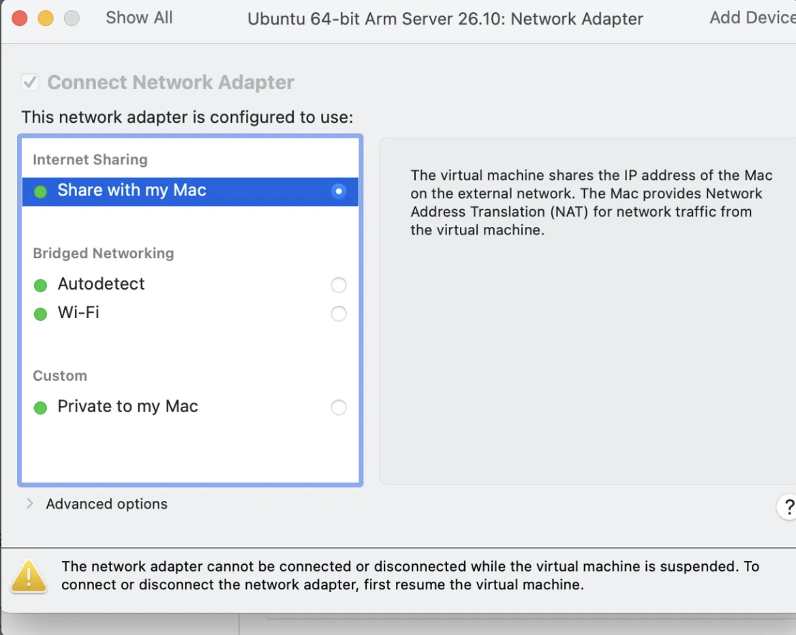
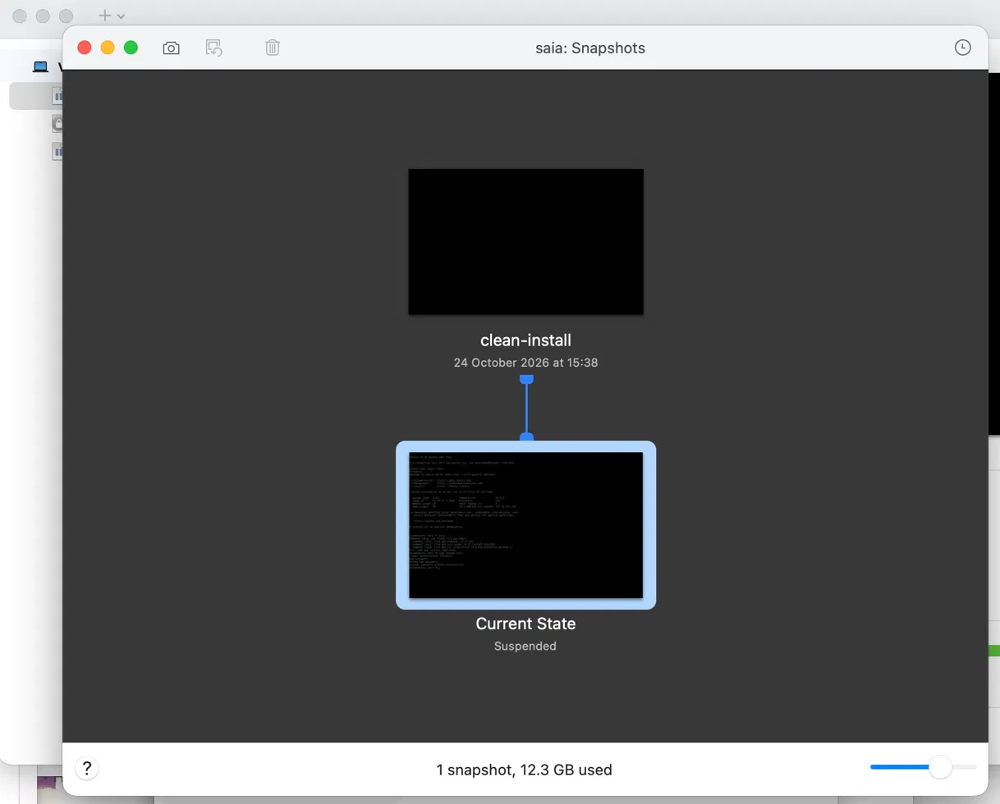

# How to build a test computer (two virtual machines) on a Mac

**Who this is for:** you do not need to know anything about servers. Follow the steps in order and do not skip the "Check" lines: they tell you if the step worked.

**What you get at the end:** two "virtual computers" that live inside one real Mac: one with Linux (Ubuntu), one with Windows 11. A new developer can break them as much as he likes, and you can put them back in one minute.

## Before you start

You need:

- A Mac with the free-to-download program **VMware Fusion** installed.
- Two installation files (called "ISO" or "disk image"), downloaded in advance:
  - Ubuntu Server for **ARM64** (from ubuntu.com)
  - Windows 11 for **ARM64** (from Microsoft)
- About 90 GB of free space and 16 GB of memory on the Mac.

> **Why ARM64 and not the usual version:** newer Macs (with M1, M2, M3, M5 chips) use a different processor type from most PCs. A normal Windows or Ubuntu file will not start. If the file name says "amd64" or "x86", it is the wrong one.

> **Windows licence:** Windows needs a licence key to be used after the trial. Ask whoever buys software for the company; this document cannot supply one.

## Part 1. The Ubuntu (Linux) machine

### Step 1. Start a new machine

In VMware Fusion open the menu **File → New**, then drag the Ubuntu ISO into the window and click **Continue**.



Why: the wizard sets up everything for you; you do not need to build a virtual computer part by part.

> Check: the window shows the name of the Ubuntu file you dragged.

### Step 2. Choose the size of the machine

Open the machine's **Settings** and set: **2 processor cores**, **6 GB memory**, **20 GB disk**.



Why these numbers: the Mac has 16 GB of memory, and the two machines together must leave enough for the Mac itself. A Linux server without a screen does not need more. The default is bigger than we need, so we lowered it.

> Check: Settings shows the numbers above.

### Step 3. Choose the network

In Settings open **Network Adapter** and choose **Share with my Mac (NAT)**.



Why NAT and not "Bridged": with NAT the virtual computer reaches the internet through the Mac, and nobody on the office network can reach it by accident. "Bridged" makes it a separate device on the office network, which the network may block.

> Check: after Step 4, the command `ip addr` shows an address beginning with `172.16.` (it will be different on your Mac).

### Step 4. Install Ubuntu

Start the machine and follow the installer. Choose the default answers unless a step below says otherwise. Create a user name and password and **write them down**.

Why: the installer asks for a user name once and never again; losing it means reinstalling.

> Check: after restart you see a text screen asking for `login:`. Type your user name and password.

### Step 5. Check that it works

At the Ubuntu prompt type:

```
uname -a
ping -c 3 8.8.8.8
```


> Check: `uname -a` prints a line starting with `Linux`; `ping` shows "0% packet loss".

## Part 2. The Windows machine

### Step 6. Start another new machine

Repeat Step 1 with the **Windows 11 ARM64** file. Set **2 cores, 4 GB memory, 64 GB disk** (**check these against your own settings**).

Why: Windows needs more than Linux to be comfortable, and 64 GB is the smallest disk the Windows installer accepts. [explain your own reason]

### Step 7. Use the same network

Choose **Share with my Mac (NAT)** again, **the same as Step 3**.

Why: both machines must be on the same network to see each other. If one used NAT and the other Bridged, they could not talk.

### Step 8. Install Windows

Follow the Windows installer. [add the steps and screenshots you saw]

> Check: you see the Windows desktop.

## Part 3. Make the machines talk to each other

### Step 9. Find each machine's address

On Ubuntu type `ip addr` and note the address beginning `172.16.`. On Windows open **PowerShell** and type `ipconfig`.

### Step 10. Test from one to the other

From Ubuntu, type `ping -c 3 <Windows address>`. From Windows, type `ping <Ubuntu address>`.


> Check: both show replies. If Windows says "Request timed out" but Ubuntu works, the Windows firewall is blocking; see the "If something goes wrong" section.

## Part 4. Save a clean copy (so nothing can be broken for good)

### Step 11. Take a snapshot

With each machine **switched on and working**, open the menu **Virtual Machine → Snapshots → Take Snapshot**. Name it `clean-install`.



Why: a snapshot is a saved moment. If the developer breaks the machine, you go back to this moment and lose only his changes.

> Check: the snapshot list shows `clean-install`.

### To go back to the clean copy

**Virtual Machine → Snapshots**, choose `clean-install`, click **Restore**.

## If something goes wrong

[Add the real problem from your own build and how you fixed it.]
