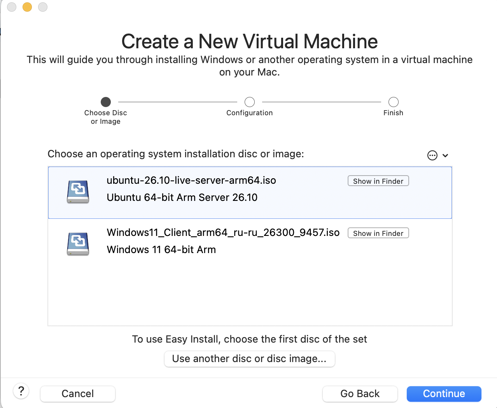
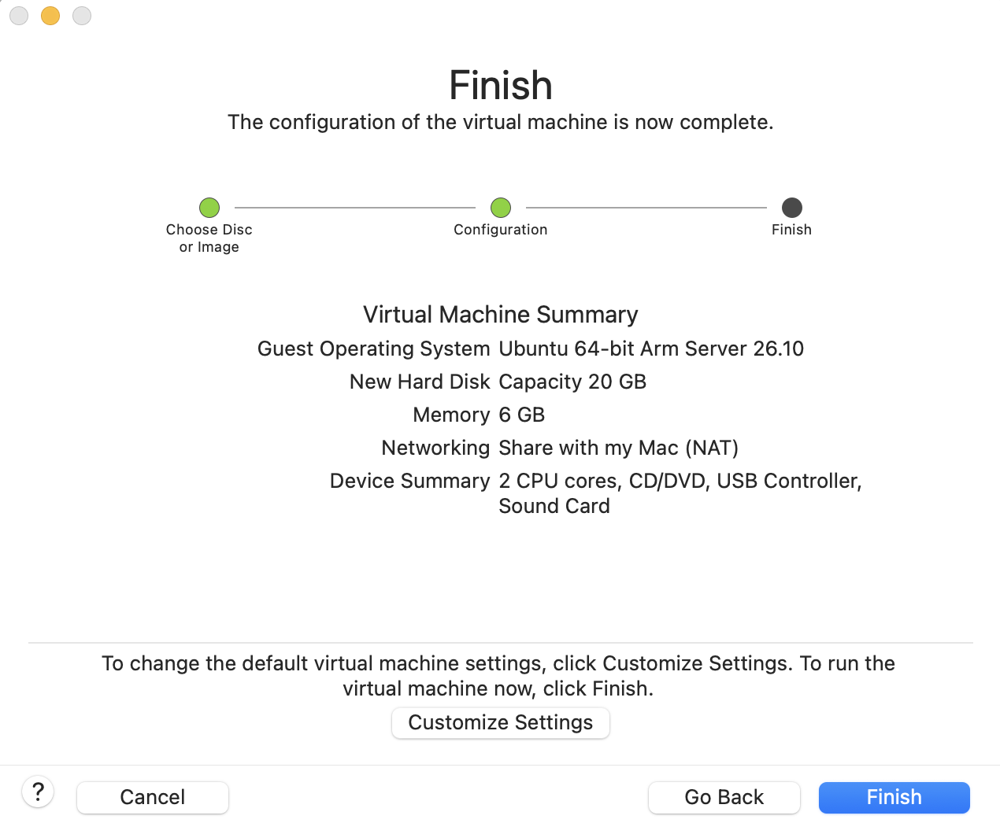
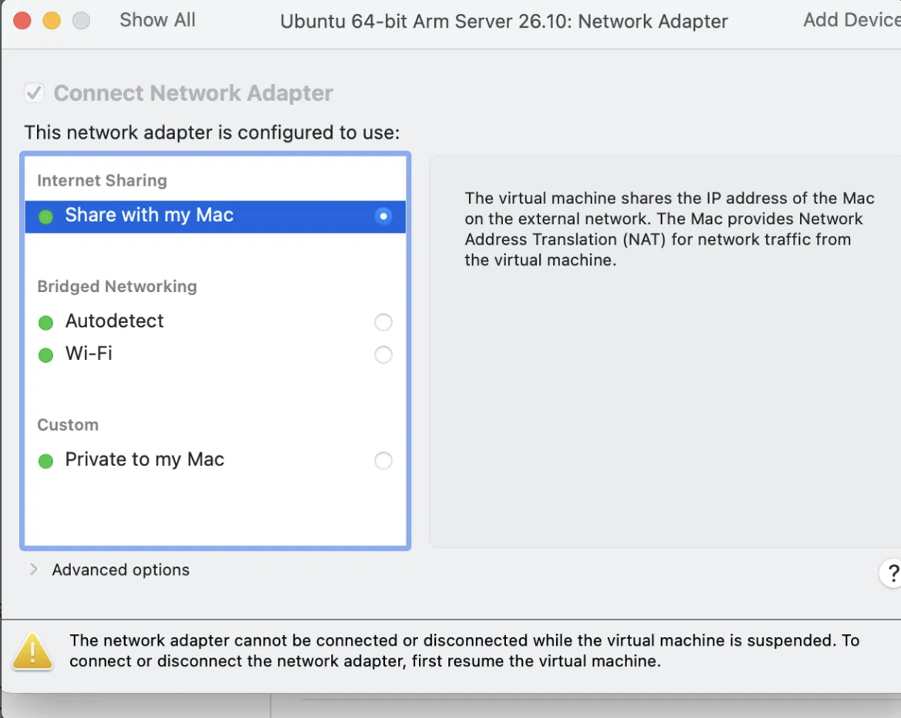
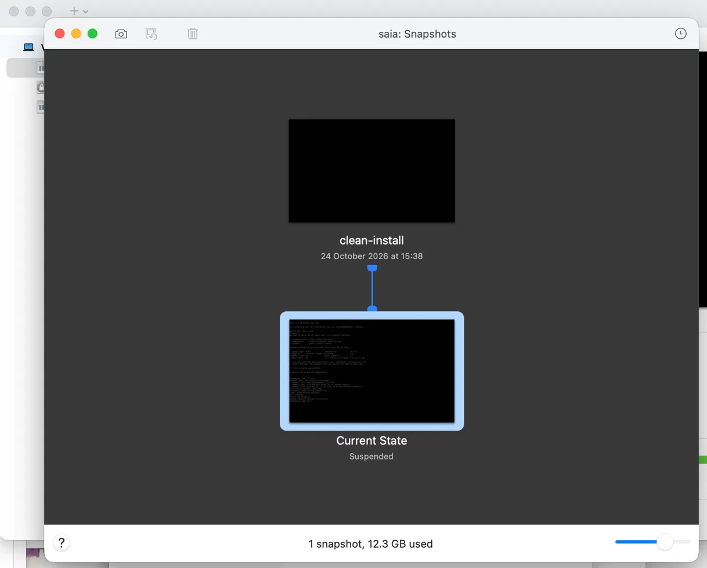

# How to build a test computer (two virtual machines) on a Mac

**Who this is for:** you do not need to know anything about servers. Follow the steps in order and do not skip the "Check" lines: they tell you if the step worked.

**What you get at the end:** two "virtual computers" that live inside one real Mac: one with Linux (Ubuntu), one with Windows 11. A new developer can break them as much as he likes, and you can put them back to a clean state in a minute.

## Before you start

You need:

- A Mac with the program **VMware Fusion** installed.
- Two installation files (called "ISO" or "disk image"), downloaded in advance:
  - Ubuntu Server for **ARM64**, for example `ubuntu-26.10-live-server-arm64.iso` (from ubuntu.com)
  - Windows 11 for **ARM64**, for example `Windows11_Client_arm64_ru-ru_...iso` (from Microsoft). Ours is the Russian edition, so the Windows installer screens are in Russian.
- About 120 GB of free space and 16 GB of memory on the Mac. (The two disks together are up to 84 GB, and snapshots take extra room.)

> **Why ARM64 and not the usual version:** Macs with Apple chips (M1, M2, M3, M5) use a different processor type from most PCs. A normal Windows or Ubuntu file will not start. If the file name says "amd64" or "x86", it is the wrong one.

> **Windows licence:** Windows needs a licence key to be used after the trial. Ask whoever buys software for the company; this document cannot supply one.

## Part 1. The Ubuntu (Linux) machine

### Step 1. Start a new machine

In VMware Fusion open the menu **File → New**, then drag the Ubuntu ISO into the window and click **Continue**.



Why: the wizard sets up the virtual computer for you, so you do not need to build it part by part.

> Check: the window shows the name of the Ubuntu file you dragged.

### Step 2. Choose the size of the machine

On the last screen of the wizard (the one called "Finish") you see a summary. Click **Customize Settings** if you need to change a number. We use **2 processor cores**, **6 GB memory**, **20 GB disk**.



Why these numbers: the Mac has 16 GB of memory, and the two machines together must leave enough for the Mac itself. Ubuntu Server has no screen and no desktop, so it needs far less than Windows.

> Check: the summary shows the numbers above.

### Step 3. Check the network

Open the machine's **Settings → Network Adapter**. It must say **Share with my Mac (NAT)**. This is the choice the wizard makes by itself; do not change it.



Why NAT and not "Bridged": with NAT the virtual computer reaches the internet through the Mac, and nobody on the office network can reach it by accident. "Bridged" makes it a separate device on the office network, which the network may block.

> Check: after Step 4, the command `ip addr` shows an address that is different from the Mac's own address.

### Step 4. Install Ubuntu

Start the machine. A text installer appears. Go through its screens in order:

1. **Language and keyboard:** pick your language and keyboard layout.
2. **Network:** leave the automatic (DHCP) setting. Why: the machine gets an address by itself, and there is nothing to type.
3. **Storage:** use the whole 20 GB disk with the default layout. Why: this is a test machine and nobody needs a special layout.
4. **Profile:** enter a server name, a user name and a password and **write them down**. When you type the password, no characters appear; this is normal.
5. **SSH:** tick **Install OpenSSH server**. Why: it lets you copy files to and from the machine later (we used it to collect the evidence files).
6. Wait for the installation to finish, then choose **Reboot**. If the installer says to remove the installation disc, press Enter.

Our machine uses the server name `saia` and the user `saia`; use your own.

> Check: after restart you see a text screen asking for `login:`. Type your user name and password.

### Step 5. Check that it works

At the Ubuntu prompt type:

```
uname -a
ping -c 3 8.8.8.8
```

Our output is saved here: [uname output](evidence/04-guest-uname.txt)

> Check: `uname -a` prints a line starting with `Linux`; `ping` shows "0% packet loss".

## Part 2. The Windows machine

### Step 6. Start another new machine

Repeat Step 1 with the **Windows 11 ARM64** file. Our settings are **2 cores, 4 GB memory, 64 GB disk** (**check these against your own settings**).

Why: Windows is heavier than a Linux server. 64 GB is the minimum storage Windows 11 requires. 4 GB of memory plus the 6 GB for Ubuntu leaves 6 GB of the Mac's 16 GB for macOS itself.

### Step 7. Check the network

In **Settings → Network Adapter** the Windows machine must also say **Share with my Mac (NAT)**.

Why: both machines must be on the same network to see each other. If one used NAT and the other Bridged, they could not talk.

### Step 8. Install Windows

Start the machine and follow the Windows installer. If a window asks for a user name and password, type them and **write them down**. If it asks for a product key and you do not have one yet, you can skip it and enter it later (see the licence note at the top). Our Windows is the Russian edition, so the installer screens are in Russian; the order of the screens is the same in any language. The machine restarts by itself a few times; wait until the desktop appears.

> Check: you see the Windows desktop.

## Part 3. Make the machines talk to each other

### Step 9. Find each machine's address

On Ubuntu type `ip addr` and note the address. On Windows open **PowerShell** and type `ipconfig`; the address is the line "IPv4".

> Addresses change. After a pause or restart a machine may get a new one (ours went from `.141` to `.143` to `.145`). Look at the address again before every test.

### Step 10. Test from one to the other

From Ubuntu, type `ping -c 3 <Windows address>`. From Windows, type `ping <Ubuntu address>`.

Our output is saved here: [ping between guests](evidence/05-ping-between-guests.txt)

> Check: both show replies and "0% packet loss". If Ubuntu cannot reach Windows, first check that Windows is running and that you used its current address (see Step 9). If both are right, the Windows firewall may be blocking incoming ping.

## Part 4. Save a clean copy (so nothing can be broken for good)

### Step 11. Take a snapshot

With each machine **switched on and working**, open the menu **Virtual Machine → Snapshots → Take Snapshot**. Name it `clean-install`.



Why: a snapshot is a saved moment. If the developer breaks the machine, you go back to this moment and lose only his changes.

> Check: the snapshot list shows `clean-install`.

### To go back to the clean copy

**Virtual Machine → Snapshots**, choose `clean-install`, click **Restore**.

## If something goes wrong

**"Operation timed out" or "Destination Host Unreachable" when connecting to a machine.** The machine's address has probably changed. Look at its current address (Step 9) and try again with that one.

**The Ubuntu disk looks smaller than 20 GB.** After the install the Ubuntu welcome message says the main disk space is only about 9.75 GB, although we gave the machine 20 GB. This does not break anything for a test machine, but if the developer needs more room, check the storage screen of the installer (Step 4, item 3).
